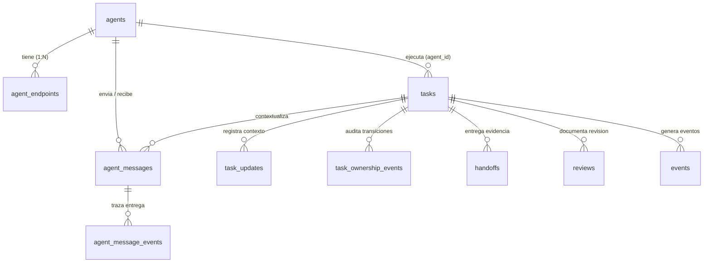

# Análisis del Modelo de Datos de Concord MCP (`.concord/`)

> **Propósito:** Documento de referencia arquitectónica generado en la **Fase 1** (`TASK-01`) tras inspeccionar en vivo `.concord/concord.db`, `.concord/events.jsonl` y `.concord/WORK_STATE.json`. Sirve como especificación base para construir la capa de dominio y acceso a datos de `concord-viewer`.

---

## 1. Arquitectura de Almacenamiento Local-First

Al inicializar Concord MCP en un repositorio, la carpeta `.concord/` mantiene tres artefactos sincronizados:

| Archivo | Formato | Rol en la Arquitectura |
| :--- | :--- | :--- |
| `concord.db` (+ `-wal`, `-shm`) | SQLite 3 (Modo **WAL**) | Fuente de verdad transaccional del estado actual (agentes, tareas, claims, mensajes, handoffs, versiones). |
| `events.jsonl` | NDJSON (1 JSON por línea) | Bitácora cronológica inmutable (*append-only*) de invocaciones de herramientas sobre el workspace. |
| `WORK_STATE.json` | JSON | Instantánea pre-computada para lectura rápida por humanos o hooks. |

### Por qué importa el modo WAL (`Write-Ahead Logging`)
La presencia de `concord.db-wal` y `concord.db-shm` confirma que SQLite opera en modo **WAL**. En este modo:
- Los escritores (el servidor MCP de Concord) agregan cambios al archivo `-wal` sin bloquear a los lectores.
- Nuestro backend en Next.js puede abrir `concord.db` con `better-sqlite3` en modo **`{ readonly: true, fileMustExist: true }`** y ejecutar consultas de lectura en paralelo con cero riesgo de corromper o bloquear las operaciones de los agentes.

---

## 2. Esquema Relacional Completo (`concord.db`)

En `sqlite_master` existen **10 tablas de dominio** organizadas en 4 pilares funcionales.



---

### Pilar A: Presencia y Conectividad de Agentes

#### 1. Tabla `agents`
Representa la identidad y estado de presencia de cada agente que ha interactuado con el workspace.

```sql
CREATE TABLE agents (
  agent_id   TEXT PRIMARY KEY,
  kind       TEXT NOT NULL,
  owner      TEXT,
  model      TEXT,
  pid        INTEGER,
  cwd        TEXT,
  worktree   TEXT,
  branch     TEXT,
  summary    TEXT,
  status     TEXT NOT NULL DEFAULT 'active',
  first_seen TEXT NOT NULL,
  last_seen  TEXT NOT NULL
);
CREATE INDEX idx_agents_last_seen ON agents(last_seen);
```

- **Campos clave:**
  - `agent_id`: Identificador único de sesión/agente (ej. `"antigravity:e9dd3dd8"`).
  - `kind`: Tipo o proveedor del agente (ej. `"antigravity"`, `"claude-code"`, `"codex"`, `"cursor"`).
  - `summary`: Resumen de una línea de la actividad actual del agente.
  - `first_seen` / `last_seen`: Timestamps ISO 8601 en UTC. Permiten calcular la **edad de latido (*heartbeat age*)** y determinar si el agente está `live` o `stale`.

#### 2. Tabla `agent_endpoints`
Registra el canal de transporte del agente para mensajería en vivo (*live steering*).

```sql
CREATE TABLE agent_endpoints (
  endpoint_id          TEXT PRIMARY KEY,
  agent_id             TEXT NOT NULL REFERENCES agents(agent_id),
  provider             TEXT NOT NULL,
  transport            TEXT NOT NULL,
  capabilities         TEXT NOT NULL DEFAULT '[]', -- JSON Array: string[]
  address              TEXT NOT NULL,
  credential_hash      TEXT NOT NULL,
  status               TEXT NOT NULL DEFAULT 'connected',
  last_seen            TEXT NOT NULL,
  expires_at           TEXT,
  created_at           TEXT NOT NULL,
  updated_at           TEXT NOT NULL,
  receiver_expires_at  TEXT,
  awaiting_user_since  TEXT,
  CHECK (status IN ('connected', 'disconnected'))
);
```

---

### Pilar B: Tareas, Reclamos de Alcance (*Claims*) y Concurrencia Optimista

#### 3. Tabla `tasks`
Es la entidad central de coordinación. **Nota de diseño fundamental:** Concord **no** utiliza una tabla `claims` separada; los reclamos de archivos y módulos viven desnormalizados como arrays JSON serializados en texto dentro de cada fila de `tasks`.

```sql
CREATE TABLE "tasks" (
  task_id           TEXT NOT NULL,
  title             TEXT NOT NULL,
  owner             TEXT,
  agent             TEXT,
  branch            TEXT,
  worktree          TEXT,
  expected_files    TEXT NOT NULL DEFAULT '[]', -- JSON Array: string[]
  modules           TEXT NOT NULL DEFAULT '[]', -- JSON Array: string[]
  domains           TEXT NOT NULL DEFAULT '[]', -- JSON Array: string[]
  risk_tags         TEXT NOT NULL DEFAULT '[]', -- JSON Array: string[]
  notes             TEXT,
  status            TEXT NOT NULL DEFAULT 'active',
  created_at        TEXT NOT NULL,
  updated_at        TEXT NOT NULL,
  parent_task_id    TEXT,
  agent_id          TEXT,
  version           INTEGER NOT NULL DEFAULT 1,
  assigned_agent_id TEXT,
  lease_expires_at  TEXT,
  project           TEXT NOT NULL DEFAULT '',
  PRIMARY KEY (project, task_id)
);
```

- **Control de concurrencia optimista (`version`):**
  Cada modificación sobre una tarea incrementa `version` (`INTEGER`). Cuando un agente invoca `finish_work`, debe enviar `expected_version`. Si otro agente modificó la tarea en el ínterin, Concord rechaza la escritura por versión obsoleta (*stale version*).
- **Detección de colisiones (*Overlaps / Collisions*):**
  Dos tareas activas (`status = 'active'`) entran en colisión cuando:
  1. **Colisión de archivo (`file`):** Intersección no vacía entre sus listas `expected_files` (normalizando separadores `\` → `/`).
  2. **Colisión de módulo (`module`):** Intersección no vacía entre sus listas `modules`.

#### 4. Tabla `task_updates`
Almacena el contexto progresivo registrado mediante `update_work` (`operation: "record"`).

```sql
CREATE TABLE "task_updates" (
  id         INTEGER PRIMARY KEY AUTOINCREMENT,
  task_id    TEXT NOT NULL,
  kind       TEXT NOT NULL, -- 'intent' | 'progress' | 'assumption' | 'decision' | 'question' | 'answer' | 'blocker' | 'finding'
  content    TEXT NOT NULL,
  agent      TEXT,
  created_at TEXT NOT NULL,
  project    TEXT NOT NULL DEFAULT '',
  FOREIGN KEY (project, task_id) REFERENCES tasks(project, task_id)
);
```

#### 5. Tabla `task_ownership_events`
Historial inmutable de transiciones de estado, cambios de dueño y saltos de versión (`from_version` → `to_version`).

```sql
CREATE TABLE "task_ownership_events" (
  id              INTEGER PRIMARY KEY AUTOINCREMENT,
  task_id         TEXT NOT NULL,
  transition      TEXT NOT NULL,
  actor_agent_id  TEXT NOT NULL,
  from_agent_id   TEXT,
  to_agent_id     TEXT,
  from_status     TEXT NOT NULL,
  to_status       TEXT NOT NULL,
  from_version    INTEGER NOT NULL,
  to_version      INTEGER NOT NULL,
  reason          TEXT,
  created_at      TEXT NOT NULL,
  project         TEXT NOT NULL DEFAULT '',
  FOREIGN KEY (project, task_id) REFERENCES tasks(project, task_id)
);
```

---

### Pilar C: Cierre, Evidencia y Revisiones (`finish_work` / `transfer_work`)

#### 6. Tabla `handoffs`
Registra la evidencia de finalización o traspaso de una tarea entre agentes.

```sql
CREATE TABLE "handoffs" (
  id                 INTEGER PRIMARY KEY AUTOINCREMENT,
  task_id            TEXT NOT NULL,
  status             TEXT NOT NULL,
  changed_files      TEXT NOT NULL DEFAULT '[]', -- JSON Array: string[]
  what_changed       TEXT NOT NULL,
  tests_run          TEXT NOT NULL DEFAULT '[]', -- JSON Array: string[]
  known_risks        TEXT NOT NULL DEFAULT '[]', -- JSON Array: string[]
  assumptions        TEXT NOT NULL DEFAULT '[]', -- JSON Array: string[]
  decisions          TEXT NOT NULL DEFAULT '[]', -- JSON Array: string[]
  guardrails_checked TEXT NOT NULL DEFAULT '[]', -- JSON Array: string[]
  needs_review_from  TEXT NOT NULL DEFAULT '[]', -- JSON Array: string[]
  next_steps         TEXT NOT NULL DEFAULT '[]', -- JSON Array: string[]
  created_at         TEXT NOT NULL,
  from_agent_id      TEXT,
  to_agent_id        TEXT,
  delivery_status    TEXT NOT NULL DEFAULT 'recorded',
  expires_at         TEXT,
  resolved_at        TEXT,
  task_version       INTEGER,
  resolution_reason  TEXT,
  reported_outcome   TEXT,                       -- JSON Object nullable
  project            TEXT NOT NULL DEFAULT '',
  FOREIGN KEY (project, task_id) REFERENCES tasks(project, task_id)
);
```

#### 7. Tabla `reviews`
Paquetes estructurados cuando una tarea queda en estado `review_ready`.

```sql
CREATE TABLE "reviews" (
  id                 INTEGER PRIMARY KEY AUTOINCREMENT,
  task_id            TEXT NOT NULL,
  plan_summary       TEXT NOT NULL,
  tests_run          TEXT NOT NULL DEFAULT '[]', -- JSON Array: string[]
  diff_size          TEXT,
  guardrails_checked TEXT NOT NULL DEFAULT '[]', -- JSON Array: string[]
  assumptions        TEXT NOT NULL DEFAULT '[]', -- JSON Array: string[]
  open_questions     TEXT NOT NULL DEFAULT '[]', -- JSON Array: string[]
  provenance         TEXT NOT NULL DEFAULT '[]', -- JSON Array: Array<{ field: string; source: string }>
  created_at         TEXT NOT NULL,
  project            TEXT NOT NULL DEFAULT '',
  FOREIGN KEY (project, task_id) REFERENCES tasks(project, task_id)
);
```

---

### Pilar D: Auditoría de Eventos y Mensajería Inter-Agente

#### 8. Tabla `events` (y su espejo en `.concord/events.jsonl`)
```sql
CREATE TABLE events (
  id         INTEGER PRIMARY KEY AUTOINCREMENT,
  task_id    TEXT,
  tool       TEXT NOT NULL,
  status     TEXT NOT NULL,
  detail     TEXT,
  created_at TEXT NOT NULL,
  project    TEXT NOT NULL DEFAULT ''
);
```

En `.concord/events.jsonl`, cada línea representa la proyección serializada sin `id` ni `project`:
```json
{"task_id":"TASK-01","tool":"claim_work","status":"success","detail":null,"created_at":"2026-11-02T20:04:09.798Z"}
{"task_id":"TASK-01","tool":"update_task","status":"success","detail":"finding","created_at":"2026-11-02T20:07:33.625Z"}
```

#### 9. Tablas `agent_messages` y `agent_message_events`
Soportan comunicación directa (`prompt` y `reply`) entre agentes activos del workspace con garantías de idempotencia (`UNIQUE (sender_agent_id, idempotency_key)`) y trazabilidad de estados (`'sent' | 'delivered' | 'read' | 'replied' | 'failed'`).

---

## 3. Decisiones de Diseño para la Fase 2 (Dominio + Acceso a Datos)

A partir de estos primeros principios del esquema, nuestra **Fase 2** aplicará tres patrones clave:

1. **Separación estricta entre `RawRow` (Infraestructura SQLite) y Entidades de Dominio:**
   - SQLite entrega columnas `TEXT` con JSON embebido (`expected_files: "[\".concord/concord.db\"]"`).
   - Ningún componente de UI ni ruta de API debe lidiar con `JSON.parse`. El repositorio transformará cada fila cruda a un objeto de dominio inmutable con arrays fuertemente tipados (`readonly string[]`) mediante *type guards* puros (sin `any` ni `as`).
2. **Lectura Segura No-Bloqueante (`readonly: true`):**
   - El módulo de SQLite abrirá `.concord/concord.db` en modo solo lectura. Si el archivo aún no existe (ej. antes de correr `concord setup`), devolverá un estado discriminado (`{ available: false, reason: ... }`) en vez de lanzar una excepción no controlada.
3. **Motor Puro de Detección de Colisiones:**
   - Una función pura de dominio recibirá las tareas activas y calculará qué archivos (`expectedFiles`) o módulos (`modules`) están siendo reclamados simultáneamente por 2 o más tareas/agentes.

